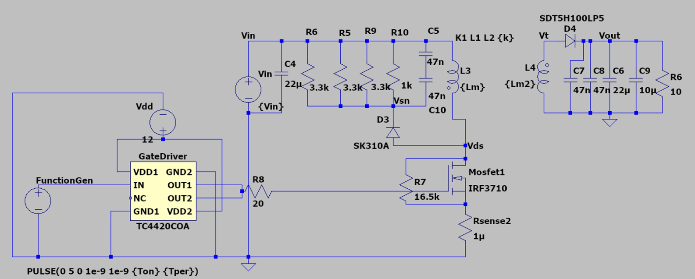

# High-Frequency (300 kHz) Flyback Converter


-FFE082)

## 🚨 Project Overview

This repository documents the design, simulation, hardware implementation, and bench validation of an isolated **DC-DC Flyback Converter** operating in **Discontinuous Conduction Mode (DCM)**. 

The primary objective was pushing switching frequency to **300 kHz** to drastically reduce magnetic core volume while mitigating the associated challenges: high-frequency switching losses, severe transformer leakage inductance spikes, parasitic capacitance, and thermal dissipation.

> **Note:** This project was developed as a collaborative team engineering project as part of the **Power Electronics** curriculum.

---

## 📜 Key Specifications

| Parameter | Symbol | Target / Design Value | Unit |
| :--- | :---: | :---: | :---: |
| **Input Voltage Range** | $V_{in}$ | 20 – 30 | V |
| **Output Voltage** | $V_{out}$ | 12 | V |
| **Output Current** | $I_{out}$ | 1.2 | A |
| **Output Power** | $P_{out}$ | 14.4 | W |
| **Switching Frequency** | $f_{sw}$ | 300 | kHz |
| **Operating Mode** | Mode | DCM across all input ranges | — |
| **Max Output Voltage Ripple** | $V_{pp}$ | < 750 | mV |
| **Target Efficiency** | $\eta$ | > 80% | — |

---

### ⚡ Circuit Schematic



---
## 📝 Engineering Design & Key Trade-offs
The converter is designed in **Discontinuous Conduction Mode (DCM)**.

### What is DCM? ($t_1$, $t_2$, and $t_3$)
In each switching period ($T = 1 / f_{sw}$), the cycle is divided into three distinct intervals:
* **$t_1$ (FET ON):** Energy is stored in the transformer core; diode is reverse-biased.
* **$t_2$ (FET OFF / Diode ON):** Energy is transferred to the load; secondary current ramps down to zero.
* **$t_3$ (Idle Dead-Time):** **Both FET and diode are OFF ($I = 0$). This dead-time is what defines DCM!** Having an intentional $t_3$ dead-band eliminates diode reverse-recovery losses and ensures zero-current turn-on (ZCS) for the MOSFET.

### 1. 300 kHz Switching Frequency Selection

* **DCM Boundary Control:** While tested up to 340 kHz at 30V input, operation dropped into Continuous Conduction Mode (CCM) at 20V. Capping at 300 kHz guaranteed robust DCM operation across all line conditions.

### 2. Custom Transformer Design
* **Core:** Ferrite EF20 / E20/10/6 with an air gap to prevent saturation and store required magnetic energy.
* **Turns Ratio:** Primary $N_p = 12\text{ turns}$, Secondary $N_s = 12\text{ turns}$ ($n = 1:1$).
* **High-Frequency Parasitics:** 
  * Mitigated skin effect using multiple parallel strands (3 strands of AWG 30 wound together).
  * Implemented sandwich winding techniques to minimize leakage inductance.

### 3. High-Speed Gate Driver (TC4420)
The selected MOSFET (IRF3710) has a significant gate charge ($Q_g$). Driving it directly with a standard microcontroller/function generator pin would lead to slow rise times ($t_r$), keeping the transistor in its linear region and causing thermal runaway. 
* A **6A peak current TC4420** non-inverting driver was implemented.
* Transition times were reduced ,minimizing switching overlap losses:

### 4. RCD Snubber & Thermal Strategy
* An aggressive RCD clamp (To clamp peak $V_{ds}$ safely below the 100V breakdown rating of the MOSFET.
* Dedicated heat sinking was added to manage combined conduction and switching dissipation.

### 5. Low-ESR Output Filtering
High-frequency ripple is dominated by capacitor ESR rather than bulk capacitance. Standard electrolytic capacitors were replaced with a parallel combination of multi-layer ceramic capacitors (MLCCs: $22\mu\text{F} + 10\mu\text{F} + 47\text{ nF}$) to suppress high-frequency ringing and ripple.

---

## ⚛️ Key Components

| Component | Part / Spec | Description |
| :--- | :--- | :--- |
| **Main Switch** | `IRF3710` | 100V, 57A N-Channel MOSFET TO-220 |
| **Gate Driver** | `TC4420COA` | 6A High-Speed Low-Side Gate Driver |
| **Rectifier Diode** | `SDT5H100LP5-7` | 100V, 5A Trench Schottky Diode ($V_F \approx 0.51\text{V}$) |
| **Snubber Diode** | `SK310A` | 100V, 3A Fast Schottky Diode |
| **Transformer Core** | `E20/10/6 (EF20)` | EE20 Bobbin, 0.4 mm Air Gap|
| **Output Capacitors** | MLCC Bank | $22\,\mu\text{F} + 10\,\mu\text{F} + 2 \times 47\text{ nF}$ (Parallel Low-ESR) |

---

## 🚀 Experimental Results


### Waveforms & Thermal Validation
**At 30 V test point:**

From oscilloscope:


From thermal camera:


Circuit:


---

## 🎯 Key Lessons Learned

1. **Gate Drive at High Frequency:**  Without a dedicated driver, the gate waveform distorts into a slow 'shark fin' RC curve, keeping the MOSFET stuck in its linear region. The gate driver helps eliminating the shark fin and cutting switching losses.
2. **Trade-off between Magnetics Size and Efficiency:** While higher switching frequency reduces core size and turn count, switching losses ($P_{sw} \propto f_{sw}$) and snubber dissipation increase proportionally.
3. **Transformer Construction:** Leakage inductance was the single most sensitive parameter; loose coupling creates destructive $V_{ds}$ voltage spikes, demanding aggressive snubber clamping at the expense of power efficiency.

---

## ✨ Acknowledgements

This project was successfully designed, simulated, assembled, and validated as **a team effort** for the **Power Electronics** course. Special thanks to the course instructor and laboratory staff for equipment and component support.
```

